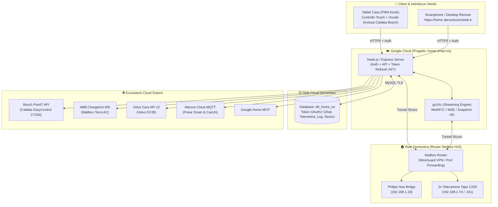

# 🏗️ Architettura e Database (`db_home_os`)

## 1. Visione Architetturale: Cloud + Home Edge (Iliadbox)

**Home Smart OS** è progettato per essere accessibile ovunque tramite HTTPS (`https://home.alexsoluzioniweb.it`) sia dal **Tablet a muro in casa** (controllo touch e vocale) sia da **Smartphone fuori casa**, mantenendo un approccio a budget zero.



---

## 2. Separazione Progetti e Infrastruttura
- **Repository GitHub**: `https://github.com/alexvezz87/home-smart-os` (Pubblico, zero dati sensibili nel codice).
- **Progetto Google Cloud**: `home-smart-os` (completamente indipendente da altri progetti come `dfn-laravel`).
- **Dominio DNS (Netsons)**: `home.alexsoluzioniweb.it`.
- **Database TiDB Cloud**: Database dedicato **`db_home_os`** (isolato da altri schemi applicativi).

---

## 3. Schema Database Implementato (`db_home_os` su TiDB Cloud)

A partire dall'Issue #2 (refactor storage TiDB Cloud), la persistenza di Home Smart OS è centralizzata nel database MySQL-compatibile con connessione TLS/SSL **`db_home_os`** (`gateway01.eu-central-1.prod.aws.tidbcloud.com:4000`).

Il modulo di riferimento è [`src/db.js`](../src/db.js), che garantisce cifratura trasparente **AES-256-GCM** per i secret, sincronizzazione bidirezionale, seed automatico dai file locali in fase di bootstrap e fallback di sicurezza in memoria se il database è temporaneamente offline.

### 📊 3.1 Struttura Tabelle Ufficiali

```sql
-- 1. Tabella Key-Value per token OAuth2, layout e configurazioni di sistema
CREATE TABLE IF NOT EXISTS kv_store (
  store_key VARCHAR(120) NOT NULL PRIMARY KEY,
  payload LONGTEXT NOT NULL,
  is_encrypted TINYINT(1) DEFAULT 0,
  updated_at TIMESTAMP DEFAULT CURRENT_TIMESTAMP ON UPDATE CURRENT_TIMESTAMP
) ENGINE=InnoDB DEFAULT CHARSET=utf8mb4;

-- 2. Tabella per serie storiche energetiche e analisi consumi
CREATE TABLE IF NOT EXISTS energy_history_store (
  history_key VARCHAR(120) NOT NULL PRIMARY KEY,
  payload LONGTEXT NOT NULL,
  updated_at TIMESTAMP DEFAULT CURRENT_TIMESTAMP ON UPDATE CURRENT_TIMESTAMP
) ENGINE=InnoDB DEFAULT CHARSET=utf8mb4;

-- 3. Registro persistente delle attività, comandi vocali e allarmi
CREATE TABLE IF NOT EXISTS activity_logs (
  id BIGINT AUTO_INCREMENT PRIMARY KEY,
  action VARCHAR(64) NOT NULL,
  message TEXT,
  meta JSON,
  created_at TIMESTAMP DEFAULT CURRENT_TIMESTAMP
) ENGINE=InnoDB DEFAULT CHARSET=utf8mb4;
```

### 🔐 3.2 Mappatura Chiavi e Sicurezza AES-256-GCM

| Tabella | Chiave (`store_key` / `history_key`) | File Locale Corrispondente | Cifrato AES-256-GCM? | Descrizione |
| :--- | :--- | :--- | :---: | :--- |
| `kv_store` | `ev-climate-config` | `ev-climate-config.json` | 🔒 **Sì** | Token OAuth2 Volvo Cars v2, credenziali Bosch SingleKey ID, Wallbox ABB |
| `kv_store` | `meross-token` | `meross-token.json` | 🔒 **Sì** | Token di sessione MQTT Meross Cloud |
| `kv_store` | `hue-config` | `hue-config.json` | 🔒 **Sì** | API Key e Bridge IP Philips Hue locale |
| `kv_store` | `security-config` | `security-config.json` | 🔒 **Sì** | Modalità allarme e credenziali RTSP/ONVIF telecamere |
| `kv_store` | `spatial-custom-layout` | `spatial-custom-layout.json` | 🔓 No | Coordinate (x, y) e stanze personalizzate dei 32 pin SVG |
| `kv_store` | `local-states-cache` | `local-states-cache.json` | 🔓 No | Cache stati accensione/luminosità dei dispositivi |
| `kv_store` | `resources-cache` | `resources-cache.json` | 🔓 No | Snapshot risorse Google Home MCP |
| `kv_store` | `iliadbox-presence-config` | *(solo TiDB)* | 🔓 No | Associazione MAC residenti (Alex/Cinzia) e `awayGraceSeconds` |
| `kv_store` | `home-presence-state` | *(solo TiDB)* | 🔓 No | Stato presenza persistito (`home`/`away`, `anyHome`) tra riavvii |
| `kv_store` | `ai-gateway-usage-YYYY-MM-DD` | *(solo TiDB)* | 🔓 No | Contatori RPD giornalieri per modello AI Gateway (`Europe/Rome`) |
| `kv_store` | `service-status-history` | *(solo TiDB)* | 🔓 No | Storico ultimi 36 controlli stato per ogni integrazione (Statuspage) |
| `energy_history_store` | `bosch-energy-history` | `data/bosch-energy-history.json` | 🔓 No | Storico completo consumi gas caldaia Bosch CT200 (PointT API) |
| `energy_history_store` | `historical-energy-analytics` | `data/historical-energy-analytics.json` | 🔓 No | Analisi consumi mensili/annuali (Volvo EX30, Wallbox ABB, Dolomiti) |
| `energy_history_store` | `appliance-cycles` | `appliance-cycles.json` | 🔓 No | Cicli lavatrice rilevati da presa smart Meross |
| `activity_logs` | *(record cronologici)* | `activity-log.json` | 🔓 No | Eventi di sistema, cambi stato, comandi vocali e audit |
| `room_temp_history` | *(serie temporale 15m)* | *(solo TiDB)* | 🔓 No | Snapshot termici per le 10 zone Bosch, sensore Corridoio Hue e caldaia (retention 60g) |
| `kv_store` | `thermal-manual-overrides` | *(solo TiDB)* | 🔓 No | Storico override manuali utente per apprendimento comfort (`#60`) |
| `kv_store` | `thermal-analytics-report` | *(solo TiDB)* | 🔓 No | Ultimo report di analisi inerzia termica e raccomandazioni (`#60`) |
| `kv_store` | `gmail_token_alex` | *(solo TiDB)* | 🔒 **Sì** | Token OAuth2 Gmail sola lettura per account Alex (`#36`) |
| `kv_store` | `gmail_token_cinzia` | *(solo TiDB)* | 🔒 **Sì** | Token OAuth2 Gmail sola lettura per account Cinzia (`#36`) |
| `kv_store` | `home-active-deliveries` | *(solo TiDB)* | 🔓 No | Metadati strutturati pacchi/consegne corrieri attivi (`#36`) |
| `kv_store` | `home-active-bills` | *(solo TiDB)* | 🔓 No | Scadenzario bollette/utenze extra-Dolomiti (`#36`) |
| `kv_store` | `gmail-processed-ids` | *(solo TiDB)* | 🔓 No | Cache ID messaggi Gmail già analizzati (max 500) (`#36`) |

### 🔄 3.3 Bootstrap Ordinato & Sincronizzazione Bidirezionale
Il ciclo di avvio di Home Smart OS in [`server.js`](../server.js) rispetta rigorosamente una sequenza asincrona ordinata in tre fasi:
1. **Fase 1 — Connessione TiDB & Idratazione Storage (`await db.initDb()`):**
   - Viene stabilita la connessione TLS verso TiDB Cloud (`db_home_os`).
   - Se in ambiente Google Cloud i file `.json` non esistono sul disco locale, `db.initDb()` scarica lo stato persistito, decifra i secret tramite `ENCRYPTION_KEY` e genera atomica-mente i file `.json` sul filesystem prima dell'avvio dei domini.
   - Se in ambiente di sviluppo locale il DB è vuoto, effettua il seed iniziale cifrato dai file locali.
2. **Fase 2 — Caricamento Moduli di Dominio:**
   - Solo a storage idratato vengono invocati i `require()` dei moduli (`ev-climate-hub`, `google-home-mcp`, `meross-energy`, `hue-local`, `security-system`, `spatial-engine`, `event-logger`, `assistant`).
   - I costruttori trovano così tutti i file JSON e i token pronti e coerenti al primo avvio.
   - Vengono inizializzati i listener telemetrici (`merossEnergy.init()`, `hueLocal.init()`).
3. **Fase 3 — Apertura Porte di Rete (`tcpServer.listen`):**
   - Il server avvia il multiplexing Dual HTTP/HTTPS solo quando tutti i servizi e le configurazioni sono pronti.

### 🛡️ 3.4 Gestione Chiave di Cifratura (`ENCRYPTION_KEY`)
- La cifratura AES-256-GCM è governata **esclusivamente** dalla variabile d'ambiente `ENCRYPTION_KEY` (presente in `.env` e nei GitHub Secrets).
- È vietato qualsiasi fallback insicuro a password del DB o stringhe fisse: se `ENCRYPTION_KEY` non è valorizzata, qualsiasi tentativo di scrittura o seed di chiavi sensibili (`ev-climate-config`, `meross-token`, `hue-config`, `security-config`) viene categoricamente bloccato con log d'errore a tutela del repository pubblico.

---

## 4. Architettura di Autenticazione e Sicurezza Edge/Cloud

A partire dalla Feature #3, **Home Smart OS** include un layer di autenticazione unificato ([`src/auth.js`](../src/auth.js)) per proteggere le API e l'interfaccia web prima dell'esposizione pubblica su `https://home.alexsoluzioniweb.it`:

### 4.1 Modelli di Accesso Supportati
1. **Tablet Kiosk a Muro (PIN Rapido)**:
   - Accesso touch frictionless mediante PIN numerico configurato in `TABLET_KIOSK_PIN`.
   - Generazione di sessione stateless HMAC-SHA256 memorizzata in un cookie `HttpOnly` (`home_smart_token`) con durata estesa a **90 giorni**, evitando disconnessioni sul tablet a muro.
2. **Accesso Fuori Casa (Google OAuth2 + Whitelist)**:
   - Login tramite Google OpenID Connect per smartphone e PC remoti (`/api/auth/google`).
   - Verifica di conformità dell'indirizzo email con la whitelist autorizzata definita in `ALLOWED_GOOGLE_EMAILS`. Qualsiasi account non registrato viene respinto con codice 403 e allarme di sicurezza.
   - Sessione cookie `HttpOnly` valida 30 giorni.

### 4.2 Livelli di Protezione & Rate Limiting
- **Protezione Middleware Universale**: Tutte le chiamate `/api/*` (eccetto `/api/auth/*` e `/callback` per redirect Volvo/Bosch) richiedono un token valido, restituendo `HTTP 401 Unauthorized` in caso contrario.
- **Protezione WebSocket RTSP**: La connessione live per lo streaming delle telecamere Tapo (`/api/stream/:cameraId`) valida l'autenticazione prima di avviare il proxy video, terminando i socket non autorizzati con codice WS 1008.
- **Anti-Brute Force**: Il modulo traccia i tentativi PIN errati per IP; dopo 5 errori consecutivi scatta il blocco temporaneo dell'indirizzo IP per 5 minuti (`HTTP 429 Too Many Requests`).
- **Header di Sicurezza Web (`helmet`)**: Configurazione automatica degli header HTTP protettivi anti-XSS e clickjacking.

---

## 5. Architettura Deploy 24/7 VPS Always Free, Docker & WireGuard Iliadbox (`#5`)

Per l'esecuzione continua a costo zero (€ 0,00/mese), il sistema supporta il deploy containerizzato su VPS Linux (`linux/amd64` Oracle/GCP `e2-micro` o `linux/arm64` Ampere) collegata alla LAN domestica tramite **WireGuard VPN Server della Iliadbox**:

1. **Containerizzazione (`Dockerfile`, `docker-compose.yml`, `.dockerignore`)**:
   - Immagine multi-arch su `node:20-bookworm-slim` con `ffmpeg` (`/usr/bin/ffmpeg`) e binario ufficiale `go2rtc` Linux (`/usr/local/bin/go2rtc`, selezionato automaticamente da `Go2RtcManager.getBinaryPath()`).
   - Immagine pubblicata su `ghcr.io/alexvezz87/home-smart-os:latest` tramite GitHub Actions (`.github/workflows/docker-publish.yml`).
2. **Reverse Proxy HTTPS (`Caddyfile`)**:
   - Terminazione TLS automatica Let's Encrypt su `home.alexsoluzioniweb.it` (DNS Netsons `A` -> IP pubblico VPS).
   - Direttiva `flush_interval -1` dedicata a `/api/events*` per streaming SSE in tempo reale senza buffering.
3. **Tunnel WireGuard & Unicast Google Nest (`src/security-system.js`)**:
   - Il server WireGuard della Iliadbox (`2f824puh.ibxos.it`)instrada il traffico verso la sottorete domestica `192.168.1.0/24` (Hue Bridge, Telecamere Tapo/ONVIF, Stampante Pantum, Google Nest).
   - `WG_LOCAL_IP` / `HOST_LAN_IP` in `getLocalHostIp()` garantiscono che i flussi `castToNestHub` usino l'IP tunnel raggiungibile dal Nest Hub.
   - La mappa `nestIps` (configurabile via `NEST_IPS`, `GET/POST /api/system/nest-ips` e TiDB `nest-ips-config`) abilita `announceToNest(text, { roomName, lang })` via `castv2-client` unicast TCP `:8009` senza dipendere da mDNS.
4. **Compatibilità Tablet Kiosk Legacy (`public/js/legacy-kiosk.js`)**:
   - Polyfill ES2019+ (`Object.fromEntries`, `Array.prototype.at`, `String.prototype.replaceAll`, `ResizeObserver`) e classe `legacy-kiosk` per disattivare `backdrop-filter` e animazioni pesanti su Chrome `< 88` / Android `< 9` (es. Asus Nexus 7).

---

## 6. Ambiente Duale Staging/Main, WAMP Locale & Sandbox Anti-Conflitto (`#71`)

Per isolare completamente lo sviluppo locale (`staging`) dalla produzione H24 sulla VPS (`main`), il sistema implementa un'architettura duale:

1. **Database Duale (`src/db.js`)**:
   - Modalità `'local'`: WAMP MySQL `127.0.0.1:3306` / `db_home_os_dev` senza SSL (auto-creazione database al primo avvio, fallback ordinato verso TiDB Cloud se WAMP è spento).
   - Modalità `'cloud'`: TiDB Cloud `db_home_os` su porta `4000` con TLSv1.2.
   - Switch a caldo con `switchMode('local' | 'cloud')` e clonazione integrale delle 4 tabelle (`kv_store`, `energy_history_store`, `activity_logs`, `room_temp_history`) tramite `cloneFromCloudToLocal()` o `npm run db:clone-wamp` (`scripts/sync-db-to-wamp.js`).
2. **Sandbox & Anti-Conflitto (`src/sandbox-manager.js`)**:
   - Modalità `'live'`, `'dry_run'` (aggiorna solo lo stato in memoria senza chiamare XMPP/PointT/Volvo/Wallbox/Hue/Nest) e `'simulator'`.
   - Arresto automatico del polling Telegram (`telegramBot.stopPolling()`) in locale per prevenire `409 Conflict` con la VPS di produzione.
   - Simulatore eventi (`simulateEvent`) per testare su `eventBus` movimento corridoio, finestra aperta, arrivo pacchi e pressione caldaia bassa.

---

## 7. Hardening Sicurezza Perimetrale: PIN Kiosk LAN-Only, JWT Effimero & Alert Telegram (`#74`)

1. **Perimetro Domestico (`isTrustedHomeNetwork` in `src/auth.js`)**:
   - Il tastierino numerico PIN (`Tablet Kiosk`, `role: 'admin'`) è consentito **esclusivamente** da loopback (`127.0.0.1`, `::1`), LAN domestica (`192.168.1.0/24`), subnet WireGuard (`192.168.27.0/24`) o IP WAN configurati in `process.env.HOME_PUBLIC_IP`.
   - Da reti esterne, `GET /api/auth/status` restituisce `kioskPinAllowed: false` (nascondendo il tastierino in `public/index.html` / `public/js/app.js`) e `POST /api/auth/kiosk-login` respinge la richiesta con **HTTP `403 Forbidden`** (`KIOSK_LAN_ONLY`), imponendo **Google OAuth 2.0** con whitelist `process.env.ALLOWED_GOOGLE_EMAILS`.
2. **Hardening Segreto JWT & Porta Container**:
   - Rimosso il fallback statico per la firma JWT: `getSessionSecret()` usa `SESSION_SECRET`, `ENCRYPTION_KEY` oppure un segreto casuale effimero per processo (`crypto.randomBytes(32)`).
   - In `docker-compose.yml`, la porta `3000` di Node è isolata su `127.0.0.1:3000:3000`, restando accessibile solo a Caddy HTTPS e in loopback.
3. **Allerte Real-Time (`security:auth_alert`)**:
   - Tentativi PIN da rete esterna, PIN errati o login Google fuori whitelist pubblicano `security:auth_alert` su `eventBus`, instradato da `src/notifier.js` come notifica critica su Telegram e Web Push.

---

## 8. Audit Unificato Totale, Backup Giornaliero Log (`01:00`) & Google Fulfillment (`#89`)

1. **Pipeline Unificata senza Duplicati (`src/logger.js`, `src/event-logger.js`, `src/notifier.js`)**:
   - `UnifiedLogger.recordAudit` supporta `persistDb: true` (via `setDbPersister` collegato a `db.addLog`) con sanitizzazione automatica di messaggi e metadati (`sanitizeForLog`).
   - `EventLogger.log()` mantiene `persistDb: false` evitando doppi inserimenti su `activity_logs`; `Notifier.send()` traccia su DB ogni notifica/alert emesso; `server.js` abilita `persistDb: true` su mutazioni/errori HTTP, eventi chiave `eventBus` (`BRIDGED_EVENTS`) e chiamate Google OAuth / Smart Home Fulfillment (`/api/google/fulfillment`).
2. **Archiviazione & Pulizia Notturna alle `01:00` (`src/log-archiver.js`, `src/db.js`)**:
   - Tabella `activity_logs` indicizzata su `created_at` (`idx_activity_created_at`).
   - `LogArchiver` mantiene caldi su TiDB gli ultimi `DB_LOG_RETENTION_DAYS=2` giorni (oggi + ieri), esporta i giorni precedenti in `data/logs-archive/YYYY-MM/audit-YYYY-MM-DD.log`, esegue verifica su disco (*Write → Verify → Delete*) e solo dopo elimina in batch da `activity_logs`.
   - Volume `./logs:/app/logs` aggiunto in `docker-compose.yml` per persistere i log live tra i deploy.

---

## 9. Architettura Modulare delle Route Express (`src/routes/*`, `#97`)

Per mantenere `server.js` snello (`< 400` righe) e separare le responsabilità per dominio senza alterare l'idratazione differita post-TiDB (`bootstrap()`):

1. **Oggetto Condiviso `services` (`server.js`)**:
   - `server.js` dichiara l'oggetto `services` con le dipendenze core (`db`, `auth`, `logger`, `logArchiver`, `getRequestBaseUrl`, `proxy`, `scriptUrl`) e i placeholder `null` per i moduli di dominio.
   - Dopo `await db.initDb()` e `db.syncAndSeed()`, `bootstrap()` popola `services.*` nello stesso ordine di inizializzazione. Ogni route handler accede ai servizi tramite `services.<modulo>` a runtime (mai destrutturato fuori dagli handler al momento del mount).
2. **I 6 Moduli di Route in `src/routes/`**:
   - `public-auth.routes.js` *(montato **prima** di `auth.middleware()`)*: healthcheck (`/api/status/health`, `/healthz`), auth Google/Kiosk, callback OAuth esterni (`/api/ev-climate/bosch/oauth-*`) e webhook Google Smart Home (`/api/google/oauth/*`, `/api/google/fulfillment`).
   - `hue-appliances-spatial.routes.js`: Philips Hue, Pantum, LG ThinQ, Dyson HP11, `/api/home`/`/api/dashboard`, domotica spaziale, controllo stanze/dispositivi e assistente AI (`/api/assistant*`).
   - `ev-climate-energy.routes.js`: garage EV (ABB Wallbox, Volvo EX30, `/callback`), Bosch CT200, `climate-optimizer`, `thermal-analytics`, Dolomiti Energia e telemetria Meross (`/api/energy*`).
   - `security-vision-nest.routes.js`: sicurezza, telecamere Tapo/ONVIF, Gemini Vision, Nest Cast/TTS e stream WebSocket `WS /api/stream/:cameraId`.
   - `mail-notifications.routes.js`: Gmail Hub, consegne/bollette, Web Push VAPID, Centro Notifiche Intelligente e pairing Telegram.
   - `admin-system.routes.js`: EventBus SSE, presenza Iliadbox, avatar casa, ambiente duale/sandbox, audit log/archivi, `/api/ai/*`, `/api/system/status` e `/api/history*`.

---

## 10. Architettura a Provider Modulari per `EvClimateHub` (`src/providers/*`, `#99`)

Per ridurre `src/ev-climate-hub.js` da `3.038` a `< 500` righe mantenendo **100% compatibilità** con tutte le chiamate esistenti e i monkey-patch dei test su `evClimateHub` / `EvClimateHub.prototype`:

1. **Core Orchestrator (`src/ev-climate-hub.js`)**:
   - Mantiene stato centrale (`wallboxState`, `volvoState`, `boschState`), caricamento/salvataggio cifrato su TiDB (`loadConfig`, `_persistConfig`, `saveConfig`, `getMaskedConfig`), `startPolling()`, mutex `_runSingleFlight()`, `syncAll()` e `getUnifiedStatus()`.
   - Aggancia i 4 provider direttamente su `EvClimateHub.prototype` via `Object.assign(EvClimateHub.prototype, ...)`.
2. **I 4 Provider in `src/providers/`**:
   - `abb-wallbox.provider.js`: autenticazione ChargerSync, sync telemetria REST, framing DES-ECB-PKCS5 e controllo WebSocket ABB Terra AC (`_abbGetToken`, `syncAbbChargerSync`, `controlWallbox`).
   - `volvo-ex30.provider.js`: OAuth2 PKCE Volvo ID, polling adattivo, sync stato batteria/ricarica/porte/climatizzazione e comandi remoti (`_volvoGetToken`, `syncVolvoEx30`, `controlVolvo`).
   - `bosch-oauth-transport.provider.js`: OAuth2 SingleKey ID (PointT API), cattura browser Playwright opzionale e fallback XMPP `bosch-xmpp` (`_ensureBoschPointtToken`, `_boschPointtGet`/`Put`/`Bulk`, `_getBoschClient`).
   - `bosch-climate-energy.provider.js`: storico giornaliero/orario caldaia gas, sync 9 zone CT200, setpoint, profili Baby Comfort e programmazione settimanale (`syncBoschEasyControl`, `setBoschZoneSetpoint`, `fetchBoschFullEnergyHistory`).

---

## 11. Architettura Modulare Frontend `AdminManager` (`public/js/admin/*`, `#101`)

Per ridurre `public/js/admin.js` da `4.023` a `< 380` righe mantenendo piena compatibilità con tutti gli `onclick="window.adminManager.*"` e le funzioni globali `window.*`:

1. **Core Shell (`public/js/admin.js`)**:
   - Mantiene `class AdminManager` (`constructor`, `escapeHtml`, `formatErrorWithLinks`, `selectTab`, `_getBadgeClass`, `_renderActiveServiceContent`, `renderView`, `renderFloorplanPane`), esportando `window.AdminManager` e `window.adminManager`.
2. **I 4 Moduli Tematici in `public/js/admin/` (inclusi in `public/index.html` subito dopo `/js/admin.js`)**:
   - `admin-climate.js`: vista e azioni Clima Bosch CT200, Baby Comfort, OAuth manuale e `climate-optimizer` (`window.toggleClimateOptimizer`, `window.evaluateClimateOptimizerNow`).
   - `admin-devices-ev.js`: luci Philips Hue, sensore corridoio (`window.saveHueSensorConfig`), prese Meross, Wallbox ABB, Volvo EX30 e storico viaggi/ricariche Drive.
   - `admin-security-nest.js`: telecamere Tapo, Gemini Vision (`window.saveGeminiApiKey`, `window.testGeminiVision`), Hub Notifiche/Telegram/WebPush, Google Nest Follow-Me / Gemini TTS, Sentinella e Persona Fidata (`toggleTrustedGuest`).
   - `admin-system-backbone.js`: registro audit/archivi log, Gmail Hub, avatar presenza, Iliadbox Wi-Fi (`window.filterIliadboxDevices`, `window.saveIliadboxConfig`), AI Gateway (`window.testAiTts`), ambiente duale WAMP/Cloud, Sandbox e pausa/arresto sistema.

---

## 12. Architettura a Provider Modulari per `SecuritySystem` (`src/security/*`, `#103`)

Per completare la **Fase 4/4** del refactoring Zero-Regression riducendo `src/security-system.js` da `2.094` a `< 320` righe e preservando al 100% compatibilità e monkey-patch su `securitySystem` / `SecuritySystem.prototype`:

1. **Core Orchestrator (`src/security-system.js`)**:
   - Mantiene `class SecuritySystem` (`constructor`, `loadConfig`, `loadExistingSnapshots`, `saveConfig`, `resolveCamera`, `getStatus`) ed espone `SecuritySystem` oltre al singleton.
   - Monta i 3 provider su `SecuritySystem.prototype` tramite `Object.assign(SecuritySystem.prototype, ...)`.
2. **I 3 Provider Tematici in `src/security/`**:
   - `nest-cast.provider.js`: mappa IP statici Google Nest WireGuard (`_parseNestIpsEnv`, `getNestIps`, `updateNestIps`, `resolveNestIp`), calcolo durata chime e streaming/annunci TTS (`_estimateWavDelayMs`, `_buildPublicMediaUrl`, `announceToNest`, `getLocalHostIp`, `stopAnyCastSessionOnDevice`, `stopNestHubCast`, `castToNestHub`).
   - `camera-ptz-onvif.provider.js`: driver Tapo/ONVIF, reachability, watcher eventi real-time, privacy, imaging, snapshot HD, PTZ, preset e simulazione movimento (`getRTSPUrl`, `updateCameraNetwork`, `getTapoClient`, `getOnvifCam`, `startOnvifEventListeners`, `attachCameraEventWatcher`, `toggleCameraPrivacy`, `captureSnapshot`, `ptzMove`, `pointToAngle`, `applyPreset`).
   - `sentinel-vision.provider.js`: Sentinella Fuori Casa, Hue Sentinel SSE, accredito temporaneo Persona Fidata (`trustedGuest`), riferimenti pet Lucifero & Camilla e Rolling Memory Buffer (`initHueSentinel`, `initSentinel`, `_isCasaAway`, `setTrustedGuest`, `runSentinelPatrol`, `pushRollingFrame`, `captureRollingFrame`).

---

## 13. Stack Tecnologico & Specifiche di Progetto (`#122`)

**Home Smart OS** adotta un'architettura **full-stack JavaScript** volutamente snella e modulare, progettata per consumare pochissima RAM sulla VPS cloud mantenendo tempi di caricamento immediati anche su smartphone e tablet Kiosk a parete (senza bundler o framework SPA pesanti).

| Livello | Tecnologie, Linguaggi & Librerie Principali |
| :--- | :--- |
| **Linguaggi** | **JavaScript (ES2022+ full-stack)**, **HTML5**, **CSS3**, **SVG** (Digital Twin), **SQL** |
| **Backend & API** | **Node.js 20 LTS** (`node:20-bookworm-slim`), **Express 5** (`^5.3.0`), `server.js` + 6 route modules (`src/routes/*`) + provider (`src/providers/*`, `src/security/*`), `ws`, **Server-Sent Events (SSE)** + `EventBus` |
| **Sicurezza & Test** | `helmet`, `cookie-parser`, `cors`, **Google OAuth 2.0**, **PIN Kiosk LAN**, `node:crypto` (**AES-256-GCM** & **HMAC-SHA1**), runner nativo **`node:test`** (`scripts/test-guardrails.js`) |
| **Frontend & PWA** | **Vanilla JS modulare a classi** (`public/js/*.js`, `public/js/admin/*.js`, `legacy-kiosk.js`, zero React/Vue/build), **Tailwind CSS** (dark glassmorphism), **Font Awesome 6.4**, **Chart.js 4.4**, **PWA** (`manifest.json`, Service Worker, `web-push` VAPID) |
| **Database & Log** | **TiDB Cloud Serverless** (`db_home_os`, `mysql2/promise` su TLS) + `LogArchiver` giornaliero su volume Docker |
| **Media, AI & Email** | **Google Gemini API** (Vision, orchestrazione, TTS), **FFmpeg** (transcodifica MP3), **Google Cast v2** (`castv2-client`), **`go2rtc`** (WebRTC/MSE/HLS), fallback **JSMpeg**, **SMTP SSL/TLS** (`nodemailer`), `pdf-parse`, `xlsx` |
| **Protocolli IoT** | **ONVIF** (`onvif`), **RTSP** (`rtsp-relay`), `tapo-camera-client`, **Philips Hue CLIP v2** (HTTPS/SSE), **Bosch EasyControl** (`@xmpp/client`, `bosch-xmpp`), **Dyson HP11** (MQTT locale), **Pantum** (IPP 2.0), **Iliadbox** (FreeboxOS API), `meross-cloud`, REST (`axios`) |
| **Infrastruttura & CI/CD** | **Docker & Docker Compose**, **GitHub Actions** (build multi-arch `amd64`/`arm64` su GHCR + sync Wiki), **Caddy 2** (HTTPS/TLS Let's Encrypt, `zstd/gzip`, SSE `flush_interval -1`), tunnel VPN **WireGuard** (VPS ↔ LAN casa) |

### 🔍 Dettaglio delle Scelte Architetturali
1. **Frontend senza bundler (`Vanilla JS + Tailwind + SVG`)**:
   - L'interfaccia è suddivisa in classi dedicate (`floorplan.js`, `drag-editor.js`, `device-sheet.js`, `energy.js`, `mobility.js`, `calendar.js`, `notifications.js`, `status.js`, `admin.js` + `admin/*.js`, più `legacy-kiosk.js` per compatibilità con tablet meno recenti).
   - La planimetria è un **Digital Twin SVG** con coordinate percentuali (`src/spatial-engine.js`), layer selettivi e supporto **WebRTC/MSE/HLS** tramite `go2rtc` (con fallback **JSMpeg**).
2. **Backend Modulare & Comunicazione Real-Time**:
   - `server.js` funge da orchestratore centrale delegando gli endpoint ai 6 moduli di `src/routes/` e l'interfacciamento hardware ai provider sotto `src/providers/` e `src/security/`.
   - Lo stream **SSE (`/api/events`)** collegato a `EventBus` consente aggiornamenti istantanei di luci, sensori, presenza Wi-Fi e notifiche senza polling aggressivo.
3. **Resilienza Cloud ↔ Casa (`VPS + WireGuard + PowerOutageWatchdog`)**:
   - L'esecuzione del server su VPS connessa via **WireGuard** (e proxy HTTPS **Caddy 2** con `flush_interval -1` su `/api/events*`) mantiene attivi i refresh OAuth2, il Bot Telegram e il `PowerOutageWatchdog` anche in caso di blackout elettrico in abitazione.

---

## 14. Fondazione Frontend Vue 3 + Vite + Pinia & Migrazione Incrementale (*Strangler Fig*, `#124`)

Per abilitare lo sviluppo di nuove viste reattive senza riscritture traumatiche dei moduli Vanilla JS esistenti, dalla Fase 0 (`#124`) il progetto affianca a `public/js/*` un workspace `frontend/` compilato in un bundle IIFE deterministico:

1. **Workspace `frontend/` (Node 16.17 & Node 20 LTS Safe)**:
   - Stack: **Vue 3** (`^3.4.38`), **Pinia** (`^2.2.2`), **Chart.js** (`^4.4.4`) + **`vue-chartjs`** (`^5.3.1`), **Vite** (`^4.5.5`) + `@vitejs/plugin-vue` (`^4.6.2`).
   - `frontend/vite.config.js` compila `src/main.js` in formato `iife` (`HomeSmartVue`) generando `public/vue/home-vue.js` e `public/vue/home-vue.css` (entrambi esclusi da Git via `.gitignore`).
2. **Store Pinia & Viste Migrate (`Stato Servizi` `#124` + `Calendario & Scadenze` `#126` + `Centro Notifiche` `#128` + `Energy Intelligence` `#130`)**:
   - `frontend/src/stores/homeStore.js` (`useHomeStore`) + `frontend/src/views/StatusView.vue` (Fase 0, `#124`): gestisce stato `/api/system/status`, filtri (`all | issues | operational`), `authExpiredServices`, micro-grafico `Doughnut` (`vue-chartjs`), barra storica a 36 tacche e aggiornamento di `#nav-status-dot`.
   - `frontend/src/stores/calendarStore.js` (`useCalendarStore`) + `frontend/src/views/CalendarView.vue` (Fase 1, `#126`): gestisce `/api/calendar/overview` (45gg), ricerca live (`searchQuery`), switch `Mese ↔ Agenda` cronologica, KPI con totale € bollette da pagare, `busyActionKey` selettivo e creazione rapida eventi (`POST /api/calendar/events`).
   - `frontend/src/stores/notificationsStore.js` (`useNotificationsStore`) + `frontend/src/views/NotificationsView.vue` + `frontend/src/views/NotificationsPopover.vue` (Fase 2, `#128`): condividono lo stesso store su `#area-notifications` e `#header-notifications-popover` con singola fetch `/api/notifications/feed` (`unreadPreview` + `counts` su 5 tab), ricerca live, azioni 1-tap (`✓ Bolletta pagata`, `📦 Pacco ricevuto`, `🗑️ Svuota archivio lette`) e aggiornamento real-time via SSE `notifications:updated`.
   - `frontend/src/stores/energyStore.js` (`useEnergyStore`) + `frontend/src/views/EnergyView.vue` (Fase 3, `#130`): gestisce tutte le 6 tab di `#area-energy` (`overview`, `gas`, `ev`, `plugs`, `thermal`, `bills`), grafici misti `Bar` + `Line` (`vue-chartjs` senza flicker al polling), modale dettaglio presa (`/api/device/:id/energy-detail`), fetch autonomo `/api/ev-climate/bosch/energy-history`, Export CSV e sincronia verso Calendario e Notifiche.
   - `frontend/src/main.js`: monta `StatusView`, `CalendarView`, `NotificationsView`, `NotificationsPopover` ed `EnergyView` sulla stessa istanza `pinia`, espone `window.homeVueBridge` e pubblica i bridge retrocompatibili `window.statusManager`, `window.calendarManager`, `window.notificationsManager` e `window.energyManager`; i rispettivi file in `public/js/*.js` restano come fallback protetti da `if (!window.*)`.
3. **Build Multi-Stage `Dockerfile`**:
   - Lo stage `node:20-bookworm-slim AS frontend-builder` installa le dipendenze in `frontend/` ed esegue `npm --prefix frontend run build`, copiando `/build/public/vue` nell'immagine finale (`/app/public/vue`).


