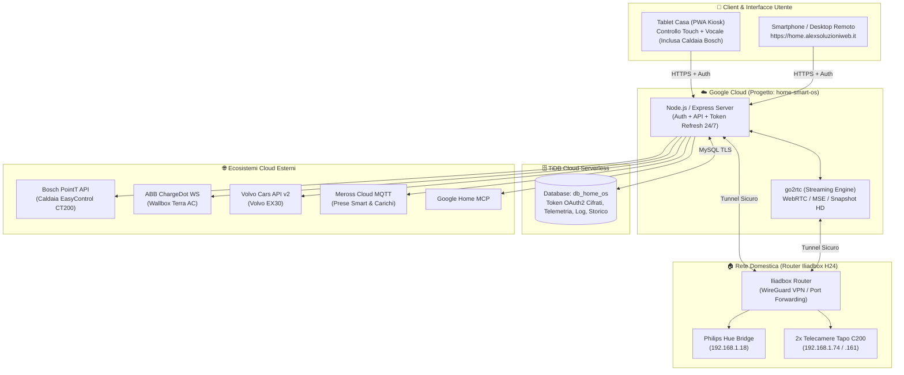

# 🏗️ Architettura e Database (`db_home_os`)

## 1. Visione Architetturale: Cloud + Home Edge (Iliadbox)

**Home Smart OS** è progettato per essere accessibile ovunque tramite HTTPS (`https://home.alexsoluzioniweb.it`) sia dal **Tablet a muro in casa** (controllo touch e vocale) sia da **Smartphone fuori casa**, mantenendo un approccio a budget zero.



---

## 2. Separazione Progetti e Infrastruttura
- **Repository GitHub**: `https://github.com/alexvezz87/home-smart-os` (Pubblico, zero dati sensibili nel codice).
- **Progetto Google Cloud**: `home-smart-os` (completamente indipendente da altri progetti come `dfn-laravel`).
- **Dominio DNS (Netsons)**: `home.alexsoluzioniweb.it`.
- **Database TiDB Cloud**: Database dedicato **`db_home_os`** (isolato da altri schemi applicativi).

---

## 3. Schema Database Implementato (`db_home_os` su TiDB Cloud)

A partire dall'Issue #2 (refactor storage TiDB Cloud), la persistenza di Home Smart OS è centralizzata nel database MySQL-compatibile con connessione TLS/SSL **`db_home_os`** (`gateway01.eu-central-1.prod.aws.tidbcloud.com:4000`).

Il modulo di riferimento è [`src/db.js`](../src/db.js), che garantisce cifratura trasparente **AES-256-GCM** per i secret, sincronizzazione bidirezionale, seed automatico dai file locali in fase di bootstrap e fallback di sicurezza in memoria se il database è temporaneamente offline.

### 📊 3.1 Struttura Tabelle Ufficiali

```sql
-- 1. Tabella Key-Value per token OAuth2, layout e configurazioni di sistema
CREATE TABLE IF NOT EXISTS kv_store (
  store_key VARCHAR(120) NOT NULL PRIMARY KEY,
  payload LONGTEXT NOT NULL,
  is_encrypted TINYINT(1) DEFAULT 0,
  updated_at TIMESTAMP DEFAULT CURRENT_TIMESTAMP ON UPDATE CURRENT_TIMESTAMP
) ENGINE=InnoDB DEFAULT CHARSET=utf8mb4;

-- 2. Tabella per serie storiche energetiche e analisi consumi
CREATE TABLE IF NOT EXISTS energy_history_store (
  history_key VARCHAR(120) NOT NULL PRIMARY KEY,
  payload LONGTEXT NOT NULL,
  updated_at TIMESTAMP DEFAULT CURRENT_TIMESTAMP ON UPDATE CURRENT_TIMESTAMP
) ENGINE=InnoDB DEFAULT CHARSET=utf8mb4;

-- 3. Registro persistente delle attività, comandi vocali e allarmi
CREATE TABLE IF NOT EXISTS activity_logs (
  id BIGINT AUTO_INCREMENT PRIMARY KEY,
  action VARCHAR(64) NOT NULL,
  message TEXT,
  meta JSON,
  created_at TIMESTAMP DEFAULT CURRENT_TIMESTAMP
) ENGINE=InnoDB DEFAULT CHARSET=utf8mb4;
```

### 🔐 3.2 Mappatura Chiavi e Sicurezza AES-256-GCM

| Tabella | Chiave (`store_key` / `history_key`) | File Locale Corrispondente | Cifrato AES-256-GCM? | Descrizione |
| :--- | :--- | :--- | :---: | :--- |
| `kv_store` | `ev-climate-config` | `ev-climate-config.json` | 🔒 **Sì** | Token OAuth2 Volvo Cars v2, credenziali Bosch SingleKey ID, Wallbox ABB |
| `kv_store` | `meross-token` | `meross-token.json` | 🔒 **Sì** | Token di sessione MQTT Meross Cloud |
| `kv_store` | `hue-config` | `hue-config.json` | 🔒 **Sì** | API Key e Bridge IP Philips Hue locale |
| `kv_store` | `security-config` | `security-config.json` | 🔒 **Sì** | Modalità allarme e credenziali RTSP/ONVIF telecamere |
| `kv_store` | `spatial-custom-layout` | `spatial-custom-layout.json` | 🔓 No | Coordinate (x, y) e stanze personalizzate dei 32 pin SVG |
| `kv_store` | `local-states-cache` | `local-states-cache.json` | 🔓 No | Cache stati accensione/luminosità dei dispositivi |
| `kv_store` | `resources-cache` | `resources-cache.json` | 🔓 No | Snapshot risorse Google Home MCP |
| `energy_history_store` | `bosch-energy-history` | `data/bosch-energy-history.json` | 🔓 No | Storico completo consumi gas caldaia Bosch CT200 (PointT API) |
| `energy_history_store` | `historical-energy-analytics` | `data/historical-energy-analytics.json` | 🔓 No | Analisi consumi mensili/annuali (Volvo EX30, Wallbox ABB, Dolomiti) |
| `energy_history_store` | `appliance-cycles` | `appliance-cycles.json` | 🔓 No | Cicli lavatrice rilevati da presa smart Meross |
| `activity_logs` | *(record cronologici)* | `activity-log.json` | 🔓 No | Eventi di sistema, cambi stato, comandi vocali e audit |

### 🔄 3.3 Sincronizzazione Bidirezionale & Seed Automatico
- **Bootstrap su Server Locale**: se il database TiDB Cloud non contiene ancora una chiave ma è presente il corrispondente file JSON locale, viene eseguito il seed automatico criptato verso TiDB Cloud.
- **Bootstrap su Google Cloud**: in ambiente cloud (o container effimeri senza file locali), `initDb()` idrata la cache e rigenera i file locali a partire dallo stato memorizzato su TiDB Cloud prima dell'avvio dei servizi.
- **Scritture Asincrone**: ogni volta che un modulo aggiorna un token o una serie storica, la scrittura su TiDB Cloud avviene in background garantendo zero latenza sull'event loop di Node.js.
