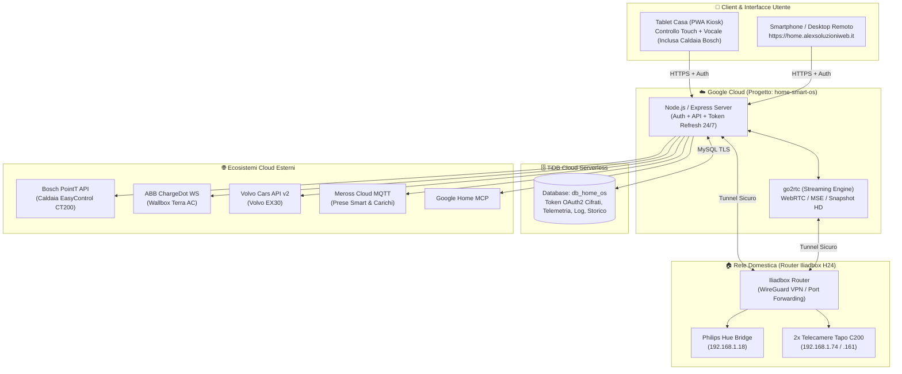

# 🏗️ Architettura e Database (`db_home_os`)

## 1. Visione Architetturale: Cloud + Home Edge (Iliadbox)

**Home Smart OS** è progettato per essere accessibile ovunque tramite HTTPS (`https://home.alexsoluzioniweb.it`) sia dal **Tablet a muro in casa** (controllo touch e vocale) sia da **Smartphone fuori casa**, mantenendo un approccio a budget zero.

---

## 2. Separazione Progetti e Infrastruttura
- **Repository GitHub**: `https://github.com/alexvezz87/home-smart-os` (Pubblico, zero dati sensibili nel codice).
- **Progetto Google Cloud**: `home-smart-os` (completamente indipendente da altri progetti come `dfn-laravel`).
- **Dominio DNS (Netsons)**: `home.alexsoluzioniweb.it`.
- **Database TiDB Cloud**: Database dedicato **`db_home_os`** (isolato da altri schemi applicativi).

---

## 3. Schema Database Previsto (`db_home_os` su TiDB Cloud)

Per eliminare la dipendenza dai file `.json` locali ed evitare qualsiasi perdita di dati durante i deploy su Google Cloud, la persistenza viene gestita nel database MySQL-compatibile **`db_home_os`**:

1. **`system_configs` & `oauth_tokens`**:
   - Archivia in modo persistente (con cifratura AES-256 per i campi segreti) i token OAuth2 autorinnovati di **Volvo Cars**, **Bosch SingleKey ID**, **Meross Cloud**, **ABB ChargeDot**, **Google Home MCP** e **Philips Hue**.
2. **`energy_history` & `bosch_gas_history`**:
   - Serie storiche orarie e giornaliere dei consumi elettrici (prese Meross, fasce F1/F2/F3), cicli elettrodomestici (`appliance_cycles`), sessioni di ricarica Wallbox ABB, storico mensile EV e consumi gas riscaldamento/ACS della caldaia Bosch CT200.
3. **`spatial_pins`**:
   - Coordinate personalizzate `(x, y)` e configurazioni delle micro-zone dei 32 pin sulla planimetria interattiva.
4. **`activity_logs`**:
   - Cronologia degli eventi di sistema, comandi vocali e allarmi sicurezza.
5. **`authorized_users` & `device_sessions`**:
   - Whitelist degli utenti autorizzati e sessioni a lunga durata per il Tablet Kiosk di casa.
